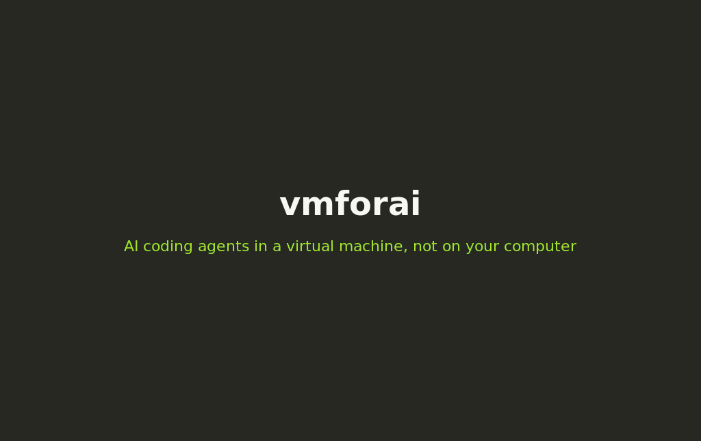

<div align="center">
  <h1>vmforai</h1>
  <p><i>Run AI coding agents inside a virtual machine, not on your computer</i></p>

  **English** · [Türkçe](README.tr.md)

  
  
  
  
  
  
  [](https://github.com/emincan2000/vmforai/actions/workflows/test.yml)

  [Install](#install) · [Why a VM?](#vmforai-a-container-or-the-cloud) · [Quick start](#quick-start) · [Terminal UI](#terminal-ui) · [Tasks](#tasks-and-yolo-mode) · [Phone](#from-the-phone) · [Projects](#projects) · [Issues](#from-an-issue-to-a-pull-request) · [Commands](#commands) · [Roadmap](ROADMAP.md)
</div>

---



**vmforai** runs Claude Code, Codex, Gemini CLI, OpenCode or aider **inside a
virtual machine**, with one command: it starts the VM, connects over SSH and
opens the agent there, in tmux. The agent may install, run and break whatever
it likes. Your computer is not touched, and every start takes a snapshot first,
so `vmforai undo` takes it all back.

```sh
curl -fsSL https://raw.githubusercontent.com/emincan2000/vmforai/main/install.sh | bash
vmforai create dev      # a new Debian VM with Claude Code in it, in a minute or two
vmforai dev             # Claude Code, running in the VM
```

**Why a VM?**

- **The agent may act without asking.** There, `rm -rf`, a careless `sudo` or a
  broken package only break the VM, and one command undoes them.
- **Nothing of yours is in it.** No SSH keys, no browser, no GitHub token, no
  other projects: a repository goes in as a copy, and the agent's work comes
  back as a git branch for you to look at.
- **A whole computer, not a container.** Its own kernel, systemd, Docker, a
  desktop if you want one; Windows too.
- **It goes on without you.** Tasks run in the background; follow them in the
  terminal UI or on your phone, with a notification when they end.

Or do it all from the **terminal UI**, `vmforai ui`:


> vmforai was called **vmagents** until 0.24 (and **vmclaude** before 0.11).
> The old commands still work, `vmf` is short for `vmforai`, and the first
> run moves the settings over by itself (on the VMs too).

## Features

| | |
|---|---|
| **One command** | `vmforai` (or `vmforai NAME`) starts the VM, connects and opens the agent. |
| **Terminal UI** | `vmforai ui`: make VMs (system, RAM, CPUs, disk, agents, ports), open shells and agents in tabs, snapshots, ports, projects. |
| **Give a task and go** | `vmforai run dev "fix the failing tests"`: an agent works on it alone, in the background; a notification comes when it is done. |
| **One task, several tries** | `vmforai try dev 3 "the task"`: three copies of the VM in seconds, each doing the task (with different agents if you like); take the best. |
| **A network on a short leash** | `vmforai net dev restricted`: the VM reaches only the hosts on its list (the agents' services, package registries, GitHub), enforced on your computer. |
| **From the phone** | `vmforai phone` shows a QR code: scan it, and the phone's browser lists your VMs, opens their agents in a terminal, gives them tasks and follows them, fixes issues, starts and stops them (over Tailscale, from anywhere). `phone notify`: a notification when a task ends or an agent waits. SSH apps get a port per VM too. |
| **Yolo, safely** | `vmforai yolo dev on`: agents act without asking first. On your computer that is risky; in a VM, `undo` takes it all back. |
| **From an issue to a pull request** | `vmforai fix dev 42 --test "npm test"`: the agent works on GitHub issue 42 in the VM, the tests run there (their output goes back to the agent when they fail), and a pull request opens when they pass. |
| **Your project, back as a branch** | `vmforai project` sends a git repository to the VM, `vmforai take` brings the agents' work back as a branch or pull request. No GitHub keys on the VM. |
| **New VMs on demand** | `vmforai create` builds a libvirt VM from an official cloud image (Debian 13, Debian 12, Ubuntu 24.04, Arch Linux); `--template node` (python, ml, go, rust, your own) sets it up for a kind of work. |
| **Undo** | Every start takes a snapshot first; `vmforai undo` puts the VM back to before the session. |
| **Sessions survive disconnects** | The agent runs in tmux. Lose Wi-Fi, connect again: same session. |
| **Shuts down when you are done** | Quit the agent and the VM powers off, unless something still uses it. Forgotten VMs shut themselves down after 30 idle minutes. |
| **Notifications** | A desktop notification when Claude on the VM asks for permission or waits for you. |
| **The VM's server in your browser** | `vmforai open dev 3000` makes the VM's port 3000 a port here. |
| **Claude's past sessions** | `vmforai history dev` lists Claude Code's conversations on the VM, shows one readable, and `--resume` goes on with it. |
| **Shared clipboard** | What Claude (or you, in tmux) copies on the VM lands in your clipboard. |
| **Five agents** | Claude Code, Codex, Gemini CLI, OpenCode, aider; installed on first use. |
| **One-step setup** | `vmforai setup` installs the SSH key (you type the VM password once), tmux, git and Claude Code. |
| **Any SSH login opens Claude** | A terminal, a phone SSH app, PuTTY, Termius; plus an app-menu launcher. |
| **Claude Code here, working there** | `vmforai mcp NAME --add` gives the Claude Code on your computer tools to run and edit things in the VM. |
| **Windows VMs too** | Detected from the SSH banner; setup installs Git for Windows and Claude Code. |
| **`vmforai doctor`** | Checks each step: VM state, IP, sshd, key login, Claude, tmux, autostart. |

A single Bash script with no dependencies beyond OpenSSH (and virsh for
libvirt VMs, Python for the UI). Several VMs, one default, plain-text profiles.

## vmforai, a container, or the cloud?

| | vmforai | A container (Docker, devcontainer) | Cloud agents |
|---|---|---|---|
| Runs | in a VM on your computer (or any machine you reach over SSH) | on your computer, sharing its kernel | on the provider's servers |
| Take it all back | `vmforai undo`, from snapshots | throw the container away and build it again | nothing to take back here |
| The agent may use | sudo, systemd, Docker, a desktop, Windows | what the image and its rights allow | what the provider's machine allows |
| Your files and keys | out of reach; a repository goes in as a copy | out of reach unless mounted | out of reach; it works on your GitHub repository |
| Agents | Claude Code, Codex, Gemini CLI, OpenCode, aider | any | the provider's own |
| Costs | your hardware | your hardware | the provider's prices |

A container is lighter and starts in a second: when that is enough, use one.
vmforai is for when the agent should have a whole machine to itself, and
you want to be able to take back all it did.

## Install

```sh
curl -fsSL https://raw.githubusercontent.com/emincan2000/vmforai/main/install.sh | bash
```

or from a clone: `git clone https://github.com/emincan2000/vmforai && cd vmforai && ./install.sh`.
It puts `vmforai` in `~/.local/bin`, with `vmf` as a short name for it; `./install.sh --uninstall` removes it.
What it uses (libvirt, QEMU, virt-install, ...) comes right after, by
itself: with apt, dnf, pacman, zypper or apk, so on Debian, Ubuntu, Fedora,
Arch, openSUSE and Alpine (sudo asks for your password); libvirt is started
and you are added to its group. `--no-deps` leaves that out. Installed some
other way, vmforai does the same on its first run in a terminal;
`vmforai deps` does it again, `vmforai deps --check` only looks.

Tried on fresh machines from start to end: Debian 13, Ubuntu 24.04 and Arch
Linux. Fedora, openSUSE and Alpine: their package names are checked, but no
one has tried them yet. The Windows computer installer below is new as well.
Tell us how it goes: [issues](https://github.com/emincan2000/vmforai/issues).
Later, `vmforai update` brings it to the latest release (checked against the
release's checksums); the UI says when there is one.

On a **Windows 10 or 11 computer**, in PowerShell:

```powershell
irm https://raw.githubusercontent.com/emincan2000/vmforai/main/install.ps1 | iex
```

It sets vmforai up in WSL (Ubuntu; it installs WSL first when needed, which
wants an administrator and a restart) and adds a `vmforai` command to
Windows. Windows 10's WSL cannot run VMs itself, so there vmforai works with
VMs from Hyper-V, VirtualBox or VMware (`vmforai add dev --host ADDRESS`);
on Windows 11 `vmforai deps` in WSL adds libvirt as well. In a Windows that
itself runs in a VM it stops and says why: WSL 2 needs nested virtualization
there, and without it Windows may not start again (`-Force` goes on anyway).

As a package: on Debian and Ubuntu the `.deb` from the
[releases](https://github.com/emincan2000/vmforai/releases)
(`sudo apt install ./vmforai_*_all.deb`); on Arch Linux the PKGBUILD in
[packaging/aur](packaging/aur) (`cd packaging/aur && makepkg -si`). Both
bring libvirt, QEMU and the rest along.

**Requirements**

- **Your computer:** Linux, bash 4+, the OpenSSH client. `virsh` for libvirt
  VMs. The UI needs Python 3 with Textual and pyte, which `vmforai ui` fetches
  by itself when [uv](https://docs.astral.sh/uv/) is installed.
- **A Linux VM:** an SSH server, `curl`, and a user that can log in with a
  password once (or already has your key). `sudo` only to install packages.
- **A Windows VM:** Windows 10 1809+ or 11 with OpenSSH Server; see
  [Windows VMs](#windows-vms).

Any VM works: libvirt/virt-manager/GNOME Boxes (qemu), VirtualBox, VMware,
Proxmox, a cloud server. Only libvirt VMs are started, stopped and
snapshotted by vmforai; start the others yourself and give their address.

## Quick start

**From nothing** (Linux with libvirt):

```sh
vmforai create dev         # new Debian VM + Claude Code, no password needed
vmforai login dev          # log Claude in (your browser, on this computer)
vmforai dev                # open Claude Code in it
```

**With a VM you already have:** run `vmforai` with no arguments; the first
time it asks for the VM's details and offers to set it up. Or by hand:

```sh
vmforai add dev --domain debian13 --user dev              # a libvirt VM: started on demand, IP found
vmforai add dev --host 192.168.1.50 --user dev            # any other VM
vmforai add vbox --host 127.0.0.1 --port 2222 --user dev  # VirtualBox NAT forward
vmforai setup dev          # key, tmux, git, Claude Code, autostart
vmforai                    # open Claude Code on the VM
```

**Logging Claude in:** `vmforai login dev` runs `claude setup-token` on your
computer, where your browser is, and stores the long-lived token on the VM in
`~/.config/vmforai/claude-env` (readable only by you there). Claude on the VM
then never shows its login screen, whose long link is hard to copy out of a
terminal. It needs Claude Code here and a Claude subscription; an API key
works too (`echo "$ANTHROPIC_API_KEY" | vmforai login dev`). These tokens are
for chatting and coding; for other account features use `/login` in Claude.
`vmforai login dev --remove` deletes it.

| Ways in | |
|---|---|
| Terminal | `vmforai` (default VM) or `vmforai dev` |
| App menu | `vmforai desktop dev` adds **Claude Code (dev)** |
| Any SSH client | `ssh dev@VM` opens Claude (autostart) |
| A shell, not Claude | `vmforai shell dev`, or quit Claude / `Ctrl-b d` |

Every command has its own help with examples: `vmforai help create`.

## Terminal UI

```sh
vmforai ui
```

The list shows your VMs with state, RAM, CPUs, load (CPU now), agents and
ports; the right side, the selected one's details, with the memory it takes
on this computer. Everything works from the keyboard, with
Vim keys too (`j`/`k` move, `l` or Enter open, `h` or Esc back).

- **New VM** (`n`): choose the system, RAM, CPUs, disk, agents, ports and a
  project. The form shows the `vmforai create` command it runs; the VM is
  then made in a tab of its own while the list stays usable.
- **Opening a VM** (Enter) asks how: a shell or one of the agents. It opens
  **inside the UI**, in a terminal tab; F1 to F6 open the others next to it.
- **One row of tabs:** the VM list first, then every terminal (on any VM),
  every VM being created and every project's changes. `Ctrl+]` goes to the
  list and back to the tab you were in.
- **Who needs you:** a terminal tab you are not looking at shows a spinner
  while its program works, and a dot (●) when it stops or rings: the agent
  finished or waits for you. The list marks that VM, and a message names the
  tab. It watches the terminal only, so it works for every agent and shells.

| New VM | Claude Code in a tab |
|---|---|
|  |  |

<details>
<summary><b>Keys</b></summary>

| On the list | |
|---|---|
| `j` / `k` | down / up |
| `Enter`, `l` | open: a shell or an agent, in a terminal tab |
| `s` | a shell on the VM, straight away |
| `n` | new VM |
| `a` | a task for an agent, done alone; followed in a tab, marked when it ends |
| `Y` | yolo: agents act without asking first (asks you once), or ask again |
| `x` | try a task on copies of the VM (each followed in a tab); with copies there, delete them |
| `i` | network: restrict it to a list of hosts; when restricted, allow a host (the last one refused is offered) or open it again |
| `H` | Claude's past sessions on the VM, in a tab: `j`/`k` through them (shown below), `r` goes on with one |
| `p` / `c` | send a project (a git repository) / its changes, in a tab (`t` there: take as a branch, `P`: pull request) |
| `f` | fix a GitHub issue of the project: its number and the test command, then followed in a tab |
| `u` | snapshots: go back to one, take one with a name and a label, relabel, delete |
| `o` | ports: forward now (`o` again stops), every time you connect, or to your LAN too |
| `t` / `r` | start or stop / RAM and CPUs (shuts the VM down first) |
| `d` | delete (type the name to confirm; VMs not made by vmforai lose only their profile) |
| `L` | language: English, Türkçe (remembered) |
| `1` … `9` | that tab (1 is the list) |
| `Ctrl+]` | back to the tab you were in |
| `q` | quit (asks first when terminals are open or a VM is being created) |

| In a terminal tab | |
|---|---|
| `F1` | shell |
| `F2` … `F6` | Claude Code, Codex, Gemini CLI, OpenCode, aider |
| `Ctrl+]` | the list |
| `F7` / `F8` | previous / next tab (also `Ctrl+PgUp` / `Ctrl+PgDn`, where the terminal passes them on) |
| drag with the mouse | selects text; letting go copies it (`Ctrl+Shift+C` too, where the terminal passes it on) |
| `F9` | opens the last link in the tab (a login link, say) in your browser here, and copies it |
| everything else | goes to the VM; the mouse wheel scrolls back |

</details>

The UI only runs `vmforai` and reads its `--json` output, so everything it
does works from the command line too. It is a
[Textual](https://textual.textualize.io/) app inside the same script, with
[pyte](https://github.com/selectel/pyte) as its terminal (or
`pip install --user 'textual>=8' pyte` without uv).

## Tasks and yolo mode

Agents ask before they run a command or change a file, because on your own
computer a wrong step can hurt. In a VM it cannot: what they do stays there,
and `vmforai undo` puts the VM back to the snapshot taken at its start. So
let them work:

```sh
vmforai yolo dev on                    # from now on, agents on dev act without asking first
vmforai dev --yolo                     # or just this once (--ask: the other way round)

vmforai run dev "fix the failing tests"         # a task: the agent works alone, in the background
vmforai run dev --codex --wait -- "add a --verbose flag"   # another agent; follow it here
vmforai runs dev                       # the tasks: running, done, failed
vmforai runs dev 3 -f                  # one task's output, followed until it ends
```

| Agent | Yolo option | A task runs as |
|---|---|---|
| Claude Code | `--dangerously-skip-permissions` | `claude -p` (its steps shown one per line) |
| Codex | `--dangerously-bypass-approvals-and-sandbox` | `codex exec` |
| Gemini CLI | `--yolo` | `gemini -p` |
| OpenCode | `--auto` | `opencode run --auto` |
| aider | `--yes-always` | `aider --message` |

A task runs in a tmux session of its own on the VM, so it goes on when your
computer disconnects or sleeps; a desktop notification comes when it ends.
Nobody is there to answer questions, so tasks always run in yolo mode. A VM
that was off is started and shut down again afterwards; while a task runs,
autostop and the idle shutdown leave the VM on. With a [project](#projects),
`vmforai changes` and `take` then bring the result back as a branch. In the
UI, `a` gives a task and follows it in a tab.

Tasks run on Windows VMs too (Claude Code only): there is no tmux there, so
the task gets a Windows process of its own, started through WMI, which goes
on when the connection ends; `runs` shows, follows and stops it the same way,
and stopping it ends everything it started.

## Try a task several times

```sh
vmforai try dev 3 "make the start page load faster"        # 3 copies, each does the task
vmforai try dev 2 --agents claude,codex -- "fix issue 42"   # Claude Code in one, Codex in the other
vmforai tries dev                     # the copies and what they changed
vmforai changes dev-t2                # look at one
vmforai take dev-t2                   # the best one, as a branch of your project
vmforai try dev --clean               # delete the copies (branches you took stay)
```

The copies (`dev-t1`, `dev-t2`, ...) take seconds: libvirt clones the VM's
disk, which shares the downloaded base image, so only what changed in the
VM is copied. Each starts once as a new cloud-init instance, so it gets its
own name, machine ID, network address and SSH host keys, then does the task
like [`vmforai run`](#tasks-and-yolo-mode) and shuts down when done. They
run at the same time, so their memory has to be free here (`--memory MB`
gives each less). The VM itself has to be off while it is copied (`--stop`
shuts it down first). Copies work from VMs made with `vmforai create`.

## Restricted network

An agent that acts without asking can also send things where it should not,
or fetch what it should not. Restrict the VM's network, and it reaches only
the hosts on its list:

```sh
vmforai net dev restricted          # only the hosts on the list, from now on
vmforai net dev                     # the list, and what was refused lately
vmforai net dev allow api.example.com *.internal.test   # more (HOST:PORT for other ports)
vmforai net dev deny github.com     # fewer
vmforai net dev open                # everything again
```

The list starts with the agents' services and installers, the package
registries (npm, PyPI, crates.io, Go, Debian, Ubuntu, Arch) and GitHub; it
is a file too, `~/.config/vmforai/net/NAME.allow`. It is enforced on your
computer, where nothing in the VM can change it: a libvirt network filter on
the VM's card lets through only SSH, DHCP, DNS and a small proxy that
vmforai runs on this computer for the VM, and the proxy lets HTTP and HTTPS
through to the hosts on the list. On the VM, proxy settings make the
agents, git, npm, pip and apt or pacman use it. The VM's libvirt network and
your other VMs are not changed. It needs python3 here; with a firewall such
as ufw, allow the VM network to reach this computer on the proxy's port
(18080 and up). In the UI, `i` restricts it, allows a host or opens it.

## From the phone

```sh
vmforai phone                         # a QR code: scan it with the phone's camera
vmforai phone ssh dev "ssh-ed25519 AAAA... termius"   # an SSH app instead (its public key)
vmforai phone notify                  # notifications on the phone (the ntfy app)
vmforai phone off                     # off again
```

The phone's browser gets a page with your VMs; tap one for its agent or a
shell, in a terminal on the phone (xterm.js). It is the same session as on
your computer: the agent runs in tmux on the VM, so start something at the
desk and look at it from the couch. A VM that is off is started. A bar gives
the keys a phone keyboard lacks (Esc, Tab, Shift+Tab, Ctrl, the arrows), and
a box below it sends a whole message at once, so the phone's own keyboard,
autocorrect and dictation work. A key from the bar goes after what you typed,
so type the start of a file name and tap Tab to complete it. The page comes back by itself when the phone
wakes up.

Tap a VM's name for the rest: give it a task and follow its output as it
works (the earlier tasks are there too, and a running one can be stopped),
fix a GitHub issue of its project ([`vmforai fix`](#from-an-issue-to-a-pull-request)),
or start and shut it down. Added to the home screen (from the browser's menu),
the page opens like an app, with its icon and the whole screen. It is light or
dark, like the phone.

Notifications come to the phone with `vmforai phone notify` (or the switch
at the bottom of the page): when a task or a fix ends, when an agent waits
for you (a permission, a question) and when a new VM is ready. They go
through [ntfy](https://ntfy.sh), free and without an account: vmforai makes
a topic with a random name, which works like a password, and shows a code
to subscribe to it in the ntfy app (Play Store, F-Droid, App Store). Tapping
one opens that VM on the page. What they say (VM names, a task's first line)
passes through ntfy.sh; `--server` uses one of your own (`--token` when it
wants one). `phone notify test` sends a test, `phone notify off` stops them.

| The VMs | One VM |
|---|---|
|  |  |

The page is a small web server on your computer, reached over
[Tailscale](https://tailscale.com) (free): encrypted, from anywhere, and
nothing is opened to the internet. Install it on the computer
(`curl -fsSL https://tailscale.com/install.sh | sh`, then `sudo tailscale up`)
and the app on the phone, with the same account. Only on the same Wi-Fi?
`vmforai phone --lan` (not encrypted then; networks of schools and hotels
often keep devices apart). The link in the QR code holds a random key and the
server answers nothing without it; `--new` makes a new one. Who connected is
logged in `~/.cache/vmforai/phone.log`. In the UI: `m`. The page's terminal
(xterm.js) comes from your computer too, fetched once and checked against its
hash, so on the same Wi-Fi the phone needs no internet.

SSH apps (Termius, Blink, JuiceSSH) work too: `phone ssh NAME KEY` puts the
app's public key on the VM and gives it a port on your computer (7701, ...)
that leads to the VM's SSH server and starts the VM first when it is off.
With autostart on, Claude Code opens as you log in.

## Projects

Let the agents work on a repository of yours, in the VM, and take back what
they did as a branch:

```sh
vmforai project dev ~/code/app   # send it: ~/projects/app on the VM; agents start there
vmforai dev                      # ...the agent works (it may run anything: it is a VM)
vmforai changes dev              # what it changed: its commits, and what it did not commit
vmforai take dev                 # all that as the branch vmforai/dev in ~/code/app
git merge vmforai/dev            # or: vmforai take dev --pr (a pull request, with gh)
vmforai project dev              # send the result (and your new commits) back
```

- Commits travel as git bundles over vmforai's SSH connection: the VM needs
  no access to GitHub and no keys, and only committed work goes there.
- `take` makes or moves a branch only; your checkout is not touched.
  Uncommitted work on the VM (new files too, not ignored ones like
  `node_modules`) comes back as one extra commit on top of the agent's own.
- Sending again replaces the VM's copy, so it is refused while the VM has work
  that was not taken back; `--discard` sends anyway and keeps that work on the
  VM under `refs/vmforai/discarded/`.
- `vmforai create web --project ~/code/app` makes a VM with the project in it.
  In the UI: `p` sends, `c` shows the changes in a tab (`t` take, `P` pull request).


## From an issue to a pull request

With a project on the VM, one command takes a GitHub issue all the way to a
pull request, while you do something else:

```sh
vmforai fix dev 42 --test "npm test"
```

1. The issue and its comments are read here, with the GitHub CLI (`gh`).
2. The project goes to the VM again, a fresh copy of what is checked out here.
3. The agent gets the issue as a task (`vmforai run`): fix it and commit.
4. The tests run on the VM. When they fail, the agent gets their output and
   tries again (`--tries`, 2 in all by default).
5. The agent's commits come back as the branch `vmforai/issue-42`.
6. When the tests pass, the branch is pushed and a pull request opens against
   the branch that was sent, saying "Fixes #42" (`--draft`, or `--no-pr` to
   stop at the branch).

- `--test` is kept for the next issue. Without one, the agent runs the tests
  it finds, and the pull request says that vmforai did not check.
- Only the agent's commits are taken; what it left lying around (caches, test
  reports) stays out, unless it committed nothing at all.
- The VM never talks to GitHub: it gets the issue's text, and the work comes
  back through vmforai as with `take`. The agent follows that text without
  asking, so when people other than you wrote some of it, `fix` says who and
  asks first (`--yes` skips that).
- Any agent: `--codex`, `--gemini`, `--opencode`, `--aider`. In the UI: `f`.

## Everyday use

### When you leave

With a libvirt VM, quitting the agent (`/exit`, or `Ctrl-C` twice) shuts the
VM down the clean way (ACPI) and waits until it is off. It stays on, and says
why, when something still uses it:

- the agent still runs in tmux because you detached with `Ctrl-b d`
  (`vmforai dev` takes you back);
- another vmforai connection is open (`vmforai shell`, `mount`, a second `vmforai dev`);
- someone is logged in on the VM (SSH; on Windows, the screen), or Claude still runs there;
- the connection broke instead of ending.

`vmforai dev --keep` leaves it on this time, `vmforai autostop dev off`
always. `vmforai stop dev` shuts it down (`--force` pulls the plug),
`vmforai start dev` boots it ahead of time, `vmforai list` shows what runs.
Machines added with `--host` only are never shut down.

**…and when you forget:** `vmforai idle dev 30` installs a small service on
the VM that shuts it down after 30 minutes in which nothing used it (`create`
sets this up). Used means an SSH session, a console login, Claude working
(from its hooks) or a busy CPU on Linux; an SSH connection, someone signed in
or Claude running on Windows. Claude waiting for you counts as unused: its
conversation is saved and `vmforai dev --continue` resumes it. Linux VMs
need systemd and sudo; Windows uses a scheduled task. `vmforai idle dev off`
removes it.

### Undo

Before vmforai starts a libvirt VM that is off, it takes a snapshot
(`auto-DATE-TIME`; instant, since the VM is off). If the agent broke something:

```sh
vmforai undo dev                                  # back to before this session (asks first)
vmforai snapshots dev                             # all snapshots, oldest first
vmforai undo dev auto-20261016-224745
vmforai snapshot dev --name clean "before the big refactor"   # one of your own, any time
```

The newest 3 automatic snapshots are kept (`vmforai autosnap dev 10`, or
`off`); your own are never deleted automatically (`--delete NAME`). They are
libvirt internal snapshots inside the VM's qcow2 disk. A snapshot of a running
VM includes its memory and returns to it running.

### Notifications

While Claude runs on the VM, `vmforai dev` starts a small background process
here that asks the VM every 15 seconds whether Claude needs you (a permission
question, or finished and waiting a minute). Then a desktop notification
appears, "Claude Code (dev)". It keeps going after `Ctrl-b d` and stops when
Claude ends or the VM shuts down.

On the VM this uses Claude Code hooks in `~/.config/vmforai/` (`hook.sh` and
`claude-settings.json`, passed with `--settings`); your own
`~/.claude/settings.json` is not changed. On Windows VMs the hooks run under
Git Bash. Needs `notify-send` here; `vmforai notify dev off` turns it off.

### Open a port

```sh
vmforai open dev 3000        # http://localhost:3000 here, opens in your browser
vmforai open dev 5173 8080   # several
vmforai open dev 9000:3000   # the VM's 3000 as localhost:9000
vmforai ports dev 3000,5173  # forward these every time you connect
```

An SSH port forward: it works when the server listens only on the VM's
`localhost`, and for VMs elsewhere. A port taken here moves to the next free
one. `Ctrl-C` ends it, then the VM shuts down if nothing else uses it.

### Clipboard

While you are connected to a Linux VM's tmux session, what lands in a tmux
paste buffer lands in your clipboard too: text Claude Code copies and what
you copy in tmux copy mode. Needs `xclip` or `xsel` (X11), `wl-copy`
(Wayland) or `pbcopy` here; `vmforai clipboard dev off` turns it off.
(VTE terminals such as GNOME Terminal and Xfce Terminal do not understand
OSC 52, which is why vmforai does it this way.)

### Other agents

```sh
vmforai dev --codex          # OpenAI Codex CLI
vmforai dev --gemini         # Google Gemini CLI
vmforai dev --opencode       # OpenCode
vmforai dev --aider          # aider
vmforai agent dev codex      # make it the default for "vmforai dev"
```

Each agent is installed on the VM the first time (Codex, OpenCode and aider
with their own installers, Gemini CLI with npm), runs in its own tmux session
and gets the same autostop, idle shutdown, snapshots and clipboard. Log in
inside the agent once: Codex's "Sign in with ChatGPT" completes in the browser
here (vmforai forwards its port 1455). API keys can go into
`~/.config/vmforai/codex-env` (or `gemini-env`, `opencode-env`, `aider-env`)
on the VM. Notifications are for Claude only, other agents for Linux VMs only.

### Claude's past sessions

```sh
vmforai history dev              # Claude Code's conversations on the VM, newest first
vmforai history dev 2            # one of them, readable: what you asked, its answers, its tools
vmforai dev --resume ID          # go on with it
```

Claude Code keeps them on the VM, in `~/.claude/projects`; reading them
needs python3 there (cloud images have it). In the UI: `H`.

### Autostart and other devices

Any interactive SSH login opens Claude; quit it or press `Ctrl-b d` for a
shell. Skip it once with `ssh -o SetEnv=LC_VMFORAI=off dev@VM`, turn it off
with `vmforai autostart dev off`. To reach the VM from **another device**
(your phone): a libvirt NAT network (`192.168.122.x`) is reachable only from
the host; use a bridged network, a port forward or a VPN such as Tailscale.

## Create a VM

```sh
vmforai create dev                                   # Debian 13, 4 GB RAM, 2 CPUs, 20 GB disk
vmforai create big --memory 16384 --cpus 8 --disk 100
vmforai create u --image ubuntu24.04
vmforai create a --image arch --agents claude,codex --ports 3000
vmforai delete dev                                   # asks you to type the name
vmforai prune                                        # free the space of unused images
```

**Templates** set up a VM for a kind of work: `vmforai create api --template
node` gives it Node.js, npm and build tools, ports 3000 and 5173. Built in:
`node`, `python`, `ml` (more RAM, CPUs and disk, Jupyter's port), `go`,
`rust`; `vmforai templates` lists them. Options change what a template
sets (`--memory 8192`). Package names are the distribution's own (build
tools are `build-essential` on Debian, `base-devel` on Arch). Your own:
`~/.config/vmforai/templates/NAME.conf` with `IMAGE=`, `MEMORY=`, `CPUS=`,
`DISK=`, `AGENTS=`, `PORTS=`, `PACKAGES=node build postgresql` and
`SETUP=npm install -g pnpm` (a command run at the end). The UI's new-VM form
offers them too.

**Tools later:** `vmforai tools dev node python` installs them in a VM that
already exists: `node`, `python`, `go`, `rust`, `java`, `build` (a C compiler
and make), or a package's own name. On Linux with the distribution's package
manager (apt, dnf, pacman, zypper, apk), on Windows VMs with
[Scoop](https://scoop.sh) (`vmforai tools win10 node python`).

Needs `virsh` and `virt-install`, QEMU, and your user in the `libvirt`
group: `vmforai deps` installs and sets up all of it.

If libvirt has no `default` storage pool yet (a fresh Arch), `create` makes
one in `/var/lib/libvirt/images`. With **ufw** on, allow the libvirt bridge
or the VM gets no IP address (vmforai says so when it happens):
`sudo ufw allow in on virbr0 && sudo ufw route allow in on virbr0 && sudo ufw route allow out on virbr0`.

What `create` does:

1. Downloads the official cloud image once into `~/.cache/vmforai/images`
   and checks it against the distribution's published SHA-512/SHA-256 sums.
2. Copies it into the libvirt pool `default` as a shared base volume. Each VM
   gets a thin copy-on-write disk on top, so a new VM takes seconds and little
   space.
3. Starts the VM with a cloud-init seed: your user with your vmforai SSH key
   and password-less `sudo` (the account has no password at all), and tmux.
4. Waits until the VM accepts the key, then runs `vmforai setup`.

| What | Where |
|---|---|
| Downloaded images | `~/.cache/vmforai/images/` |
| Base images, one per image release | `/var/lib/libvirt/images/vmforai-base-IMAGE-CHECKSUM.qcow2` |
| Each VM's own disk (only its differences) | `/var/lib/libvirt/images/NAME.qcow2` |
| Each VM's cloud-init settings | `/var/lib/libvirt/images/NAME-seed.iso` |

`vmforai images` shows them with sizes and the VMs that use each; `prune`
removes base volumes no VM is built on, and the download cache. The VM is on
libvirt's `default` NAT network and shows up in virt-manager like any other
(other pools or networks: `VMFORAI_POOL`, `VMFORAI_NETWORK`). Arch's image
comes from `geo.mirror.pkgbuild.com`; pick another mirror with
`VMFORAI_ARCH_MIRROR` (the checksum still comes from Arch's own server).

`delete` only deletes VMs that `create` made: the profile has to say so, and
so does the VM's libvirt description ("created by vmforai").

<details>
<summary>Two details that real runs turned up</summary>

The seed is a virtio disk, not virt-install's `--cloud-init` CD-ROM, because
the Debian 12 cloud kernel has no driver for that SATA CD-ROM. And the VM gets
a video device even without a screen, because without one the GRUB of the
Debian cloud images resets the VM in a loop.

</details>

## Claude Code on your computer, working in the VM

Besides running Claude inside the VM, you can let the Claude Code on your own
computer reach into it:

```sh
vmforai mcp arch --add      # = claude mcp add --scope user arch -- vmforai mcp arch
```

Every Claude Code session then has four more tools (see `/mcp`):

| Tool | Does, inside the VM |
|---|---|
| `run` | run a command (bash on Linux, PowerShell on Windows); output and exit code come back |
| `read_file` | read a file, with line numbers |
| `write_file` | create or overwrite a file; folders are created |
| `edit_file` | replace exact text, like Claude's own Edit tool |

Ask in plain words, e.g. *"in the arch VM, write ~/work/app.py and run it"*.
Paths are relative to the profile's `DIR`; the VM is started when needed;
files travel over SFTP. Remove with `claude mcp remove arch --scope user`.

**Or the VM's folder as a local folder** (needs `sshfs`):

```sh
vmforai mount arch          # ~/vm/arch is now the VM's working folder
cd ~/vm/arch && claude       # Claude Code edits the VM's files with its normal tools
vmforai umount arch
```

Commands started in that folder still run on your computer; run things in
the VM with `vmforai shell arch 'make test'` or the `run` tool above.

## Windows VMs

Turn on the SSH server in Windows once, in an administrator PowerShell (or
Settings → Apps → Optional features → OpenSSH Server):

```powershell
Add-WindowsCapability -Online -Name OpenSSH.Server~~~~0.0.1.0
Start-Service sshd; Set-Service sshd -StartupType Automatic
```

Then it works as on Linux:

```sh
vmforai add win10 --domain win10 --user emin   # or --host IP
vmforai setup win10
vmforai win10
```

<details>
<summary>What is different on Windows</summary>

- **No tmux.** Closing the connection ends Claude's session; `claude
  --continue` picks the conversation up again.
- **setup** puts your key in `~\.ssh\authorized_keys`, and for administrators
  also in `C:\ProgramData\ssh\administrators_authorized_keys` (the only file
  Windows OpenSSH reads for them). It installs Git for Windows (winget, else
  the official installer from GitHub) and Claude Code the way
  `https://claude.ai/install.ps1` does, downloading with `curl.exe` because
  `Invoke-WebRequest` in PowerShell 5.1 times out on the 270 MB binary.
- **Autostart** goes into your PowerShell profile. That needs PowerShell as
  OpenSSH's default shell and an execution policy that runs profile scripts;
  a `Restricted` user policy is set to `RemoteSigned` (it says so).
  `vmforai shell NAME` opens PowerShell without Claude.
- Commands go as `powershell -EncodedCommand`, which works under `cmd.exe`
  and PowerShell alike. Claude's arguments pass through Windows' own
  command-line rules, so quotes, spaces and trailing backslashes arrive unchanged.
- Claude Code on Windows sometimes stays after you quit it under OpenSSH;
  vmforai notices the console switching back to line mode and ends it.

</details>

## Commands

```
vmforai                         connect to the default VM (asks to add one if none)
vmforai NAME [CLAUDE_ARGS...]   connect to VM NAME, e.g. vmforai dev --continue
vmforai NAME --codex|--gemini|--opencode|--aider [ARGS...]   another agent this time
vmforai ui                      the terminal UI

vmforai create NAME [options]   make a new Linux VM and set it up
    --image debian13|debian12|ubuntu24.04|arch  --memory MB  --cpus N  --disk GB
    --agents claude,codex,gemini,opencode,aider  --ports 3000,5173  --project DIR  --template NAME
    --user USER  --uri LIBVIRT_URI  --idle MINUTES|off  --no-setup
vmforai resize NAME [--memory MB] [--cpus N] [--stop]
vmforai delete NAME [--yes]     delete a VM made with create, and its disk
vmforai images | prune          downloaded images and where they are / remove unused ones
vmforai templates               what create --template offers
vmforai tools NAME TOOL...      node, python, go, rust, java, build in the VM (Linux or Windows)
vmforai deps [--check]          what vmforai uses on this computer, installed

vmforai add NAME [options]      add an existing VM, or change fields of a profile
    --host HOST  --user USER  --port PORT  --key FILE
    --domain LIBVIRT_DOMAIN  --uri LIBVIRT_URI  --dir DIR_ON_VM
    --session TMUX_SESSION  --no-tmux
vmforai setup NAME [--agents LIST] [--no-install] [--no-autostart]
vmforai connect [--keep] [--hold] [--no-tmux] [NAME] [-- CLAUDE_ARGS...]
vmforai shell [--keep] NAME [CMD...]   plain shell or command on the VM
vmforai start NAME | stop NAME [--force]

vmforai run NAME [--AGENT] [--wait] TASK   a task for an agent, done alone in the background
vmforai runs NAME [ID] [-f|--stop] [--clean] [--json]   the tasks; one's output
vmforai history NAME [N|ID]     Claude Code's sessions on the VM; one, readable
vmforai yolo NAME on|off        agents act without asking first (once: vmforai NAME --yolo)
vmforai try NAME N [--agents LIST] [--memory MB] [--stop] TASK   N copies, each doing the task
vmforai tries NAME | try NAME --clean   the copies / delete them
vmforai net NAME [restricted|open|allow HOST...|deny HOST...|blocked]   the VM's network

vmforai project NAME [DIR]      send a git repository here to the VM (--discard, --off)
vmforai changes NAME [--stat]   what the agents changed in it there
vmforai take NAME [--branch B] [--pr]   that work as a branch here (or a pull request)
vmforai fix NAME ISSUE [--test CMD] [--tries N] [--no-pr] [--draft]   an issue to a pull request

vmforai open [NAME] [PORT...]   the VM's port here, in your browser ([LOCAL:]PORT; --lan)
vmforai ports NAME 3000,5173    ports forwarded each time you connect (off: none)
vmforai phone [--lan] [--new] [--port N] | phone off   your VMs on the phone: a QR code to scan
vmforai phone notify [off|test] [--server URL] [--token T]   notifications on the phone (ntfy)
vmforai update [--check]        vmforai itself, at its latest release
vmforai phone ssh NAME KEY|off  an SSH app on the phone into the VM (a port here per VM)
vmforai undo NAME [SNAPSHOT]    back to before this session (or to SNAPSHOT)
vmforai snapshot NAME [--name SNAP] [LABEL]   take one; snapshots NAME lists them
vmforai snapshot NAME --label SNAP LABEL      change a snapshot's label
vmforai autosnap NAME N|off     automatic snapshots to keep (default 3)
vmforai autostop | autostart | notify | clipboard NAME on|off
vmforai idle NAME MINUTES|off   the VM shuts itself down when unused (create sets 30)
vmforai agent NAME [AGENT]      what "vmforai NAME" opens
vmforai login NAME [--remove]   log Claude in on the VM with this computer's browser
vmforai mcp NAME [--add]        tools for Claude Code here to work in the VM
vmforai mount NAME [FOLDER]     the VM's folder as a folder here; umount NAME
vmforai doctor NAME             check every step
vmforai list [--json] | default NAME | desktop NAME | edit NAME | forget NAME | rm NAME
```

Claude arguments apply when a new tmux session starts; an existing session is
reattached as it is. `vmforai help COMMAND` (or `COMMAND --help`) explains
each command with examples.

## Configuration

Profiles are plain `KEY=VALUE` files in `~/.config/vmforai/hosts/NAME.conf`,
parsed, never executed:

```
HOST=192.168.122.48     # optional with DOMAIN
USER=dev
PORT=22
IDENTITY=~/.ssh/vmforai_ed25519
DOMAIN=debian13         # libvirt domain
LIBVIRT_URI=qemu:///system
DIR=~/work              # where the agent starts on the VM (created if missing)
SESSION=claude          # tmux session; empty = no tmux
OS=linux                # or windows; detected from the SSH banner on first use
AGENT=claude            # or codex, gemini, opencode, aider
AGENTS=claude,codex     # installed on the VM
PORTS=3000,5173         # forwarded to this computer while connected
PROJECT=~/code/app      # the git repository sent with "vmforai project"
YOLO=off                # on: agents act without asking first
NET=open                # restricted: only the hosts on its list (vmforai net); NETPORT: its proxy's port
AUTOSTOP=on             # off: the VM keeps running after you leave
AUTOSNAP=3              # automatic snapshots to keep; 0 = none
IDLE=30                 # what "vmforai idle" set up on the VM (0 = off)
NOTIFY=on               # desktop notifications
CLIPBOARD=on            # copies on the VM land in this computer's clipboard
```

Environment: `VMFORAI_CONFIG_DIR` (another config folder),
`VMFORAI_BOOT_TIMEOUT` (seconds to wait for the VM, default 180),
`VMFORAI_STOP_TIMEOUT` (seconds to wait for a shutdown, default 120).

<details>
<summary><b>How it works</b></summary>

- `ssh -l USER -p PORT -i KEY -o HostKeyAlias=vmforai-NAME`. The host key is
  stored under the profile name in vmforai's own `known_hosts`, so a VM whose
  DHCP address changes keeps its identity. The first connection accepts the
  key; after that a changed key is refused until `vmforai forget NAME` (for
  example after reinstalling the VM).
- On the VM a short POSIX `sh` script adds `~/.local/bin` to `PATH`, goes to
  `DIR` and runs `tmux new-session -A -s claude claude ...`. Arguments are
  quoted for `sh`, so the user's login shell (bash, zsh, fish) does not matter.
- Booting libvirt VMs: `virsh start`, then `virsh domifaddr`, then wait for the
  `SSH-2.0` banner. NAT forwards (passt, slirp, VirtualBox) accept connections
  before sshd is up, so an open port alone is not enough.
- vmforai does not change the VM's sshd settings. Once key login works, you
  may want to turn off password login (`PasswordAuthentication no`).

</details>

## Tests

```sh
python3 -m unittest discover -s tests -t .
```

The tests run vmforai against fake `ssh`, `virsh`, `virt-install` and
`curl`; the scripts meant for the VM really run, under `sh`, in a throwaway
home directory. CI runs them on every push, with shellcheck.

<details>
<summary>What the automatic tests cover</summary>

- `test_cli.py`: the commands against fake `ssh` and `virsh`; the autostart
  hook in real interactive bash and zsh on a pseudo-terminal.
- `test_e2e.py`: the real OpenSSH client against a local SSH server
  (`asyncssh`): password then key login, host-key pinning, quoting through a
  real remote shell.
- `test_login.py`: the token reaches Claude however it is started and never
  appears on a command line.
- `test_mount.py`, `test_mcp.py`: `mount`/`umount` with a fake sshfs; MCP
  spoken to `vmforai mcp` the way Claude Code does, every tool.
- `test_create.py`: `create` and `delete` (which refuses VMs it did not make),
  the missing `default` pool, the UI under uv, and a Turkish locale (built
  with `localedef` when it is not installed).
- `test_windows.py`: OS detection, and the PowerShell commands sent, decoded;
  tasks on Windows (the task and runner sent with scp, the start script, list,
  log, stop, clean).
- `test_stop.py`: autostop, `start`, `stop`; every reason to keep a VM on.
- `test_snapshots.py`: automatic snapshots and their pruning, names, labels, `undo`.
- `test_idle_notify.py`: `hook.sh` with Claude's hook input, the watcher, the idle installers.
- `test_extras.py`: `open` (a fake ssh that really listens), the clipboard,
  the agents, the Windows hooks.
- `test_projects.py`: a real git repository sent to the fake VM and back, with
  real git on both sides: commits, changed, new and ignored files, the refused
  re-send, `--discard`, only new commits sent later.
- `test_runs.py`: tasks against a fake tmux on the fake VM: the agents' options,
  the log (Claude's steps one per line), `--wait`, stop, clean, the notification.
- `test_deps.py`: `deps` against fake apt-get, dnf, pacman, zypper and apk:
  what is missing, the package names of each, uv, libvirt's service and group.
  `test_tools.py`: `tools` on a fake Linux VM and the Scoop script for Windows.
- `test_update.py`: `update` against a fake GitHub on a copy of the script:
  the check, the swap, a wrong checksum or file refused, older releases, the
  daily cache, a git checkout.
- `test_fix.py`: an issue to a pull request, with real git, a fake `gh` and a
  fake agent that commits: the task, failing tests going back to the agent,
  what the tests and the agent left kept out, the push and the pull request,
  text by others, no change, the VM going off again.
- `test_try.py`: copies against a fake libvirt that keeps domains and volumes:
  new name, UUID, MAC and cloud-init seed, one at a time, the agents taking
  turns, shutting down after their task, `--clean`; the newest lease winning,
  and a new address while a VM boots.
- `test_net.py`: the proxy with real connections (allowed, refused, HTTP and
  HTTPS, the list read again, ending with the VM), and `net` against a fake
  libvirt: the filter, the VM's card, the VM's proxy settings, open again.
- `test_phone.py`: the QR code (compared with the `qrcode` library), the web
  server with a real WebSocket client (the page, the list, wrong keys, a
  terminal with its size and exit code, a task's output, a fix), the actions
  (tasks, stop, power; names and options refused), the terminal library from
  here or the CDN, the icon and manifest, the SSH forward, `phone ssh` putting
  the key on the fake VM and taking it off.
- `test_templates.py`, `test_history.py`: templates for `create` (built in,
  your own, the package names per distribution) and Claude's sessions.
- `test_ui.py` (needs Textual and pyte, else skipped): the UI with Textual's
  test pilot against a fake `vmforai`: Vim keys, language, the new-VM form,
  snapshots, terminal tabs on a real pseudo-terminal, creating in a tab,
  projects and changes, the working/waiting marks. `test_ui_backend.py`: the
  `--json` output and options it builds on.

</details>

<details>
<summary>What was tried by hand, on real VMs</summary>

- `vmforai create` on libvirt 11.3 with all four images (Debian 13, Debian
  12, Ubuntu 24.04, Arch Linux): download, checksum, base volume, VM,
  cloud-init, Claude Code, doctor, shut down and start again, `delete`, `prune`.
- Inside the Arch VM: connect, detach and reattach, autostart on a plain
  `ssh` login, and the whole test suite. On a Debian 13 cloud image: setup,
  connect, autostart and skipping it with `LC_VMFORAI=off`.
- Autostop (quit: off; `Ctrl-b d`, a second connection, an SSH login: stays
  on), idle shutdown after 1 minute, a snapshot at each start and `undo`, live
  snapshots, notifications; on Arch and on Windows 10.
- `vmforai open` with a web server on the VM; the clipboard with real tmux
  (Turkish letters too); Codex, Gemini CLI, aider and OpenCode installed and
  started, Codex's login page through port 1455.
- Claude Code hooks in Claude Code 2.1, and on Windows 10 under Git Bash, with
  the notification arriving here.
- `vmforai mcp`: a real `claude -p` session that wrote, ran, edited and
  re-ran a program in the Arch VM with only these tools; `mount` both ways.
- Windows 10 22H2: setup (key as administrator, Git via the fallback
  installer, Claude Code), doctor, connect, autostart, `shell`, and 13 hard
  arguments (quotes, trailing backslash, `%PATH%`, `&|<>^`, Turkish) byte for byte.
- The UI in a real terminal: a VM made from the form, resized and deleted;
  shells and Claude Code in tabs (tmux's line drawing included), Turkish,
  snapshot names and labels on real libvirt.
- Projects on the Arch VM: git installed by `project`, an agent's commit and
  uncommitted files in `changes`, the refused re-send, `take`, merge, send
  again; in the UI the changes tab and a shell tab going from working to waiting.
- On the Arch VM: a real Claude Code task (`run --wait`, steps shown, listed by
  `runs`); `try` with two copies of 2 GB, each with its own address, its task
  done by Claude and shut down after; the restricted network (Anthropic's API
  and GitHub reached, example.com refused by the proxy, a direct connection
  dropped by the filter, a Claude task through it, everything gone after
  `open`); the AUR package built and installed with `makepkg -si`; `history`.
- `deps` on the Arch VM: libvirt, QEMU, virt-install, xorriso, dnsmasq and uv
  installed with pacman, libvirtd started, the user in the libvirt group,
  `virsh` answering; `tools` with Go and Rust there; then `undo`. Each
  distribution's package names checked against its own package index.
- `tools` on the Windows 10 VM: Scoop installed, then Node.js (and `jq`) with
  it, found in a new SSH session. `install.ps1` there: the WSL features
  installed; after the restart Windows hung at its logo (WSL 2's hypervisor in
  a KVM VM), so the VM went back to its snapshot, and the installer now
  refuses inside a VM unless told otherwise.
- `fix` on the Arch VM with Claude Code: a bug in a small Python project fixed
  and tested on the VM, the branch pushed (to a local origin; the GitHub side
  through a fake `gh`), a second run on a fresh copy, the caches left out.
- Tasks on Windows 10: a real Claude Code task with `--wait`, one in the
  background going on after the connection closed, listed, stopped (with what
  Claude had started in the background), cleaned.
- The phone page in Chromium at phone size: the list, a shell and Claude Code
  on the Arch VM (started by it), the message box, the session ending; a QR
  code decoded by jsQR; an SSH client through `phone ssh`, starting the VM.
  The new page, light and dark, at phone size; against the Arch VM: started,
  a Claude Code task given and its output followed live, a long one stopped
  (nothing left running), shut down; the terminal library fetched from the CDN
  and its hashes checked.

</details>

## Limitations

- Only libvirt VMs are started, stopped and snapshotted. Other hypervisors
  (VirtualBox, VMware, Hyper-V, a cloud VM) work through `--host`: connect,
  open, clipboard, notifications, idle shutdown; start them yourself.
- Windows VMs have no tmux, so sessions end with the connection; skipping
  autostart with `LC_VMFORAI=off` works on Linux VMs only.
- The clipboard, other agents, projects and the restricted network need a Linux VM;
  on Windows, tasks run with Claude Code only. Copies
  (`try`) need a VM made by vmforai; the restricted network a libvirt VM on a libvirt network.
- A plain `ssh` login never shuts the VM down (vmforai is not running then;
  the idle shutdown does, later). The idle shutdown cannot see long jobs that
  use little CPU (a download, a `sleep`).
- The UI tells "working" from "waiting" by the terminal's output only: a
  program busy without printing anything for a few seconds looks like it waits.
- Tested on Linux hosts. macOS needs bash 4+ (Homebrew) and `timeout` (coreutils).

## License

MIT. If vmforai saved you some setup time, a ⭐ on GitHub helps others find it.
